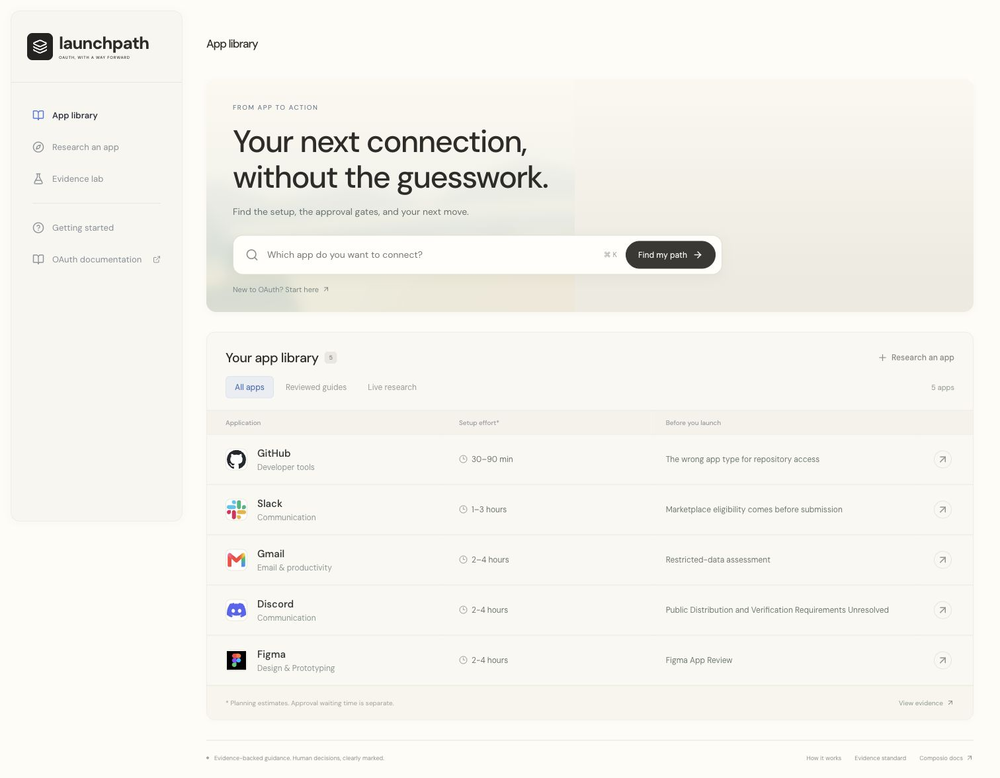
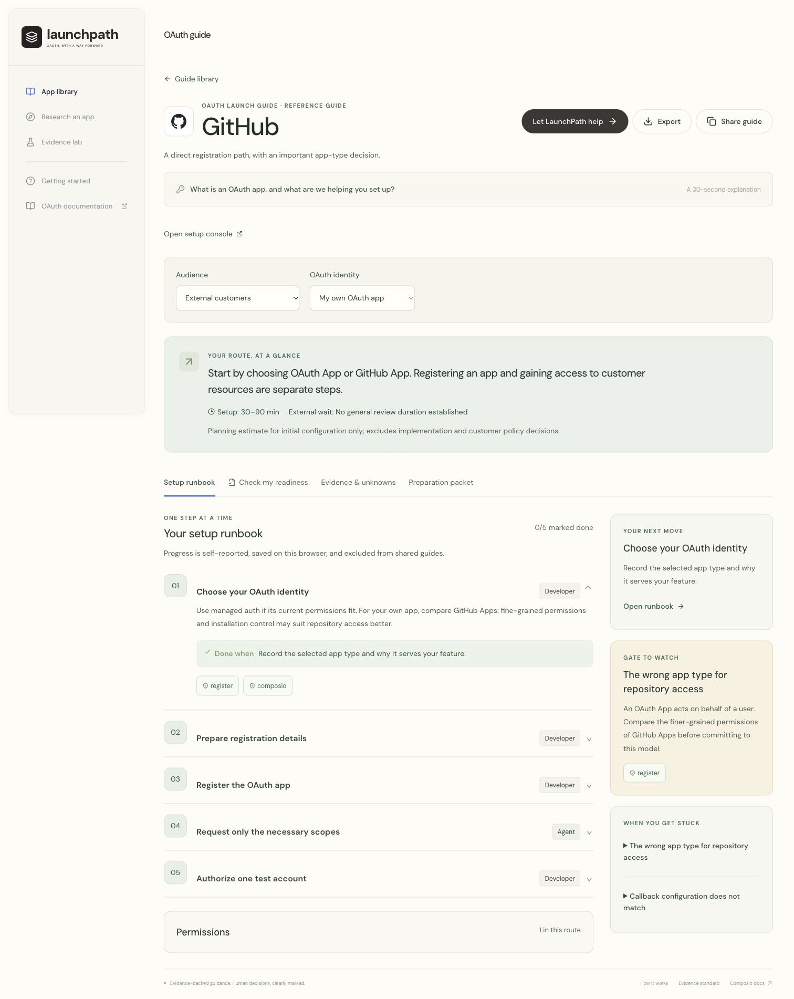

# LaunchPath

[Try it live](https://launchpath-lpry.onrender.com)

I built LaunchPath to answer one question: what will it actually take to get this app connected and ready for users?

Search for an app and get a guide with the setup steps, permissions, approval gates, expected effort and what to do next. If the app is missing, the research agent investigates its documentation and creates a guide you can share.

## A look inside





## What it does

1. Starts with reviewed guides for GitHub, Slack and Gmail, each with a different setup challenge.
2. Researches unfamiliar apps live, with sources and unanswered questions kept visible.
3. Separates setup effort from approval waiting time, and agent tasks from things you need to do yourself.
4. Prepares a setup worksheet and useful files. For supported apps, it can also start a managed OAuth connection through Composio.

I focused on the path to launch, because a successful sign in alone does not mean an app is approved for everyone to use. The guide structure supports a larger library without building a separate page for every app.

## Run locally

Use Node.js 22.14 or newer.

```sh
npm ci
cp .env.example .env.local
npm run dev
```

Open <http://127.0.0.1:3000>. Keep your existing `.env.local` if you already have one.

Add `GEMINI_API_KEY` and `TAVILY_API_KEY` for live research. Add `COMPOSIO_API_KEY` from your own test project for managed connections. The hosted demo uses my test project. Keep all keys on the server.

```sh
npm test
npm run typecheck
npm run build
```

## What I checked

All 45 automated checks pass. I also tested live guide generation, saved guides across deployments, and a real GitHub connection with consent followed by an authenticated API call.

Generated guidance still needs a human check. Real Slack and Gmail consent flows, custom app registrations and provider approvals have not been completed. This is a reviewer demo, with limited abuse controls and no full user account system.

The demo uses Render and Postgres. The free app may take about a minute to wake up. **The free database expires on 29 November 2026** and needs to be moved or upgraded before then.

[Demo walkthrough](docs/DEMO.md) · [Research findings](docs/FINDINGS.md) · [Testing details](docs/TESTING.md) · [Deployment](docs/DEPLOYMENT.md)
